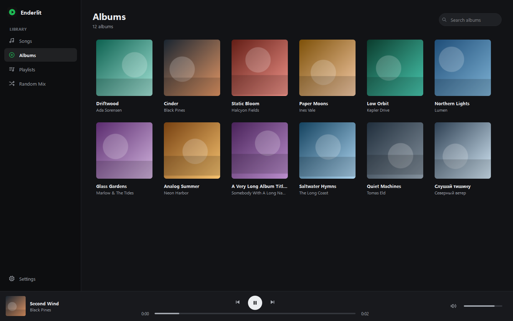
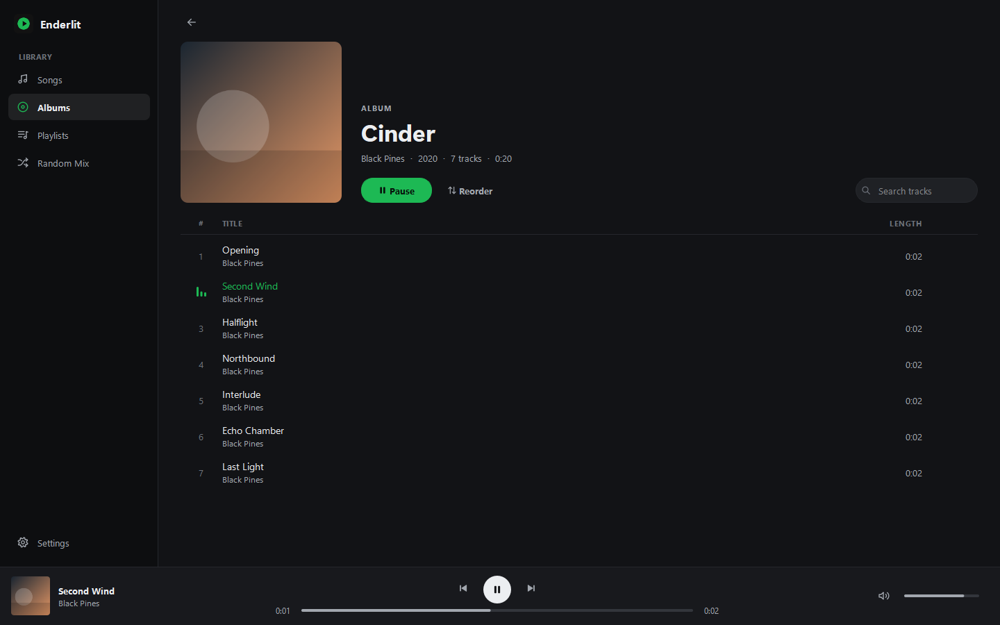
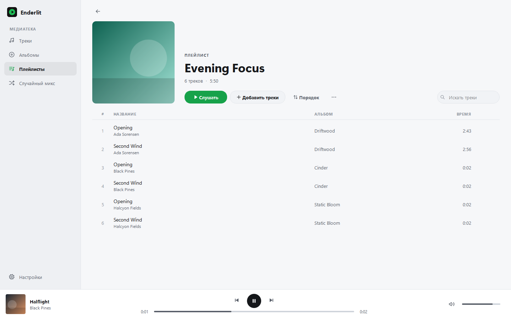
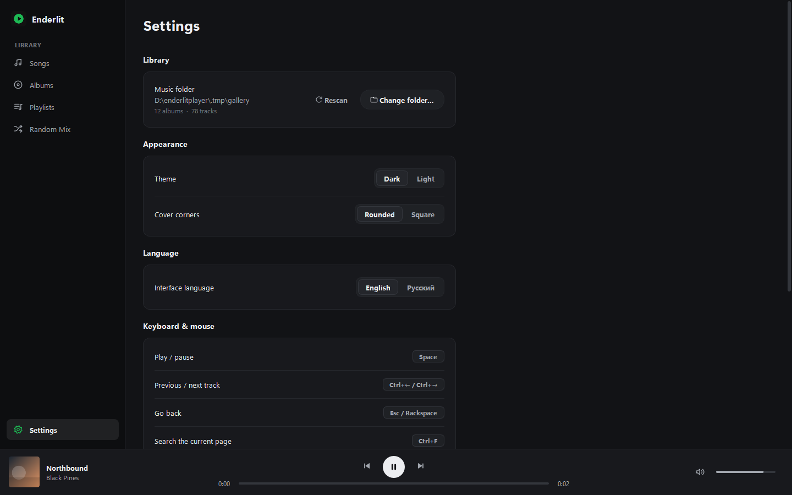

# Enderlit Player

A desktop music player for local music libraries. Version 2.0 is a complete redesign and
rewrite of the application: a modern dark-first interface, a modular Python package, automated
tests and automated Windows releases.

[English](#english) · [Русский](#русский)



| Album | Playlist (light theme, Russian) | Settings |
| --- | --- | --- |
|  |  |  |

---

## English

### Download

Get the latest build from the [Releases page](https://github.com/endercodezz/enderlitplayer/releases/latest):

1. Download `EnderlitPlayer-<version>-Windows-Portable.zip` (and optionally `SHA256SUMS.txt`).
2. Extract the archive anywhere and run `EnderlitPlayer\EnderlitPlayer.exe`.

No installation and no Python are required. To verify the download in PowerShell:
`Get-FileHash .\EnderlitPlayer-2.0.0-Windows-Portable.zip -Algorithm SHA256` and compare with `SHA256SUMS.txt`.

### The 2.0 interface

* **Sidebar** — Songs, Albums, Playlists, Random Mix and Settings. Collapses to icons in narrow windows.
* **Albums** — a responsive artwork grid. Hover a cover to play it straight away; click to open it.
* **Album / playlist pages** — large artwork, title and details, a primary Play button, reordering,
  search within the list, and per-track actions on hover (edit details, remove from playlist).
* **Player bar** — artwork and track info (click to jump to what's playing), previous / play-pause /
  next, a seek bar with timestamps, and volume with mute.
* **Settings** — music folder and rescan, theme, cover corner style, language, keyboard shortcuts and
  About (version and project link).

### Features

* Scans a folder recursively for `mp3`, `flac`, `m4a`, `aac`, `ogg`, `opus`, `wav`.
* Albums are grouped by folder, not by tags.
* Embedded artwork, or `cover.jpg` / `folder.jpg` / `front.jpg` / any image in the album folder.
* All songs view with search across title, artist and album.
* Playlists: create, rename, custom cover image, add tracks from any album, reorder, remove, delete.
  Tracks that are temporarily unavailable stay in the playlist.
* Custom track order for albums and playlists (arrow buttons or `Alt+↑/↓` in Reorder mode, or by
  editing the track number). Orders persist across rescans.
* Metadata editing (title, artist, track number) and audio file renaming.
* Random Mix: 20 random tracks, kept until you ask for a new mix.
* After the last track of an album, playback continues with a random different album.
* Remembers the last track and position, volume, folder, theme, cover style, language and window size.
* Dark and light themes; English and Russian interface.

### Keyboard and mouse

| Action | Shortcut |
| --- | --- |
| Play / pause | `Space` |
| Previous / next track | `Ctrl+←` / `Ctrl+→` (media keys also work) |
| Go back | `Esc`, `Backspace`, mouse Back button |
| Reopen the last album or playlist | mouse Forward button |
| Search the current page | `Ctrl+F` |
| Library settings | `Ctrl+L` |
| Edit the selected track | `F2` or `Ctrl+E`; `Ctrl+S` saves in the editor |
| Play the selected track / open the selected album | `Enter` |
| Move a track while reordering | `Alt+↑` / `Alt+↓` |

### Upgrading from 0.x

Settings are stored in the same place with the same keys (`QSettings("EnderLit", "EnderLitPlayer")`),
so playlists, custom track orders, the Random Mix, playback position, volume and preferences carry over
automatically. No migration step is needed.

### Run from source

Requires Python 3.10 or newer.

```bash
python -m venv .venv
.venv\Scripts\activate          # Linux/macOS: source .venv/bin/activate
pip install -e .
python -m enderlitplayer        # or: enderlitplayer
```

### Development

```bash
pip install -e ".[dev]"
python -m ruff check src tests scripts
python -m ruff format src tests scripts
python -m pytest
```

Tests run without audio hardware: playback logic uses an in-memory media backend, test audio files
are generated on the fly (silent WAV/MP3/FLAC), and UI smoke tests use Qt's `offscreen` platform.

The code is organised as a package under `src/enderlitplayer` — see [ARCHITECTURE.md](ARCHITECTURE.md).

### Build for Windows locally

```bash
build.bat            # or: powershell -File build.ps1   or: python scripts/build_windows.py
```

The script renders the icon, writes the version metadata, runs PyInstaller in `onedir` mode, checks that
the Qt multimedia plugins were bundled, launches the frozen app with `--smoke-test`, and produces
`dist/EnderlitPlayer-<version>-Windows-Portable.zip` and `dist/SHA256SUMS.txt`.

### GitHub Actions

* **CI** (`.github/workflows/ci.yml`) — on every push and pull request, on Windows and Linux: syntax and
  import checks, Ruff lint and format, pytest, and building/validating the wheel and sdist.
* **Release** (`.github/workflows/release.yml`) — on tags `v*`: verifies the tag matches the app version,
  runs the checks, builds the portable ZIP on Windows, verifies checksums and publishes the GitHub Release
  with the ZIP and `SHA256SUMS.txt`. Nothing is published if any step fails.

To release: bump `__version__` in `src/enderlitplayer/__init__.py`, add a `CHANGELOG.md` entry, then
`git tag vX.Y.Z && git push origin vX.Y.Z`.

---

## Русский

### Скачать

Последняя сборка — на [странице релизов](https://github.com/endercodezz/enderlitplayer/releases/latest):

1. Скачайте `EnderlitPlayer-<версия>-Windows-Portable.zip` (и при желании `SHA256SUMS.txt`).
2. Распакуйте архив в любую папку и запустите `EnderlitPlayer\EnderlitPlayer.exe`.

Установка и Python не нужны. Проверить файл в PowerShell:
`Get-FileHash .\EnderlitPlayer-2.0.0-Windows-Portable.zip -Algorithm SHA256` — хеш должен совпасть с `SHA256SUMS.txt`.

### Интерфейс 2.0

* **Боковая панель** — Треки, Альбомы, Плейлисты, Случайный микс и Настройки. В узком окне сворачивается до иконок.
* **Альбомы** — адаптивная сетка обложек. Наведите курсор на обложку, чтобы сразу включить альбом; щелчок открывает его.
* **Страницы альбомов и плейлистов** — крупная обложка, название и сведения, основная кнопка «Слушать»,
  изменение порядка, поиск по списку и действия над треком при наведении (изменить данные, убрать из плейлиста).
* **Панель плеера** — обложка и трек (щелчок открывает то, что играет), предыдущий / пауза / следующий,
  шкала перемотки со временем, громкость и отключение звука.
* **Настройки** — папка с музыкой и пересканирование, тема, вид углов обложек, язык, горячие клавиши
  и «О программе» (версия и ссылка на проект).

### Возможности

* Рекурсивно сканирует папку: `mp3`, `flac`, `m4a`, `aac`, `ogg`, `opus`, `wav`.
* Альбомы группируются по папкам, а не по тегам.
* Обложки из тегов или из `cover.jpg` / `folder.jpg` / `front.jpg` / любого изображения в папке альбома.
* Список всех треков с поиском по названию, исполнителю и альбому.
* Плейлисты: создание, переименование, своя обложка, добавление треков из любых альбомов, порядок,
  удаление треков и плейлистов. Временно недоступные треки не удаляются из плейлиста.
* Свой порядок треков в альбомах и плейлистах (стрелки или `Alt+↑/↓` в режиме «Порядок» либо через номер
  трека). Порядок сохраняется между сканированиями.
* Редактирование тегов (название, исполнитель, номер) и переименование аудиофайлов.
* Случайный микс: 20 случайных треков, обновляется по кнопке.
* После последнего трека альбома включается случайный другой альбом.
* Запоминает последний трек и позицию, громкость, папку, тему, вид обложек, язык и размер окна.
* Тёмная и светлая темы; английский и русский интерфейс.

### Клавиатура и мышь

| Действие | Сочетание |
| --- | --- |
| Пауза / продолжить | `Пробел` |
| Предыдущий / следующий трек | `Ctrl+←` / `Ctrl+→` (и мультимедийные клавиши) |
| Назад | `Esc`, `Backspace`, кнопка мыши «Назад» |
| Вернуться к последнему альбому или плейлисту | кнопка мыши «Вперёд» |
| Поиск на текущей странице | `Ctrl+F` |
| Настройки медиатеки | `Ctrl+L` |
| Изменить выбранный трек | `F2` или `Ctrl+E`; `Ctrl+S` сохраняет в редакторе |
| Включить трек / открыть альбом | `Enter` |
| Переместить трек в режиме порядка | `Alt+↑` / `Alt+↓` |

### Обновление с 0.x

Настройки хранятся там же и под теми же ключами (`QSettings("EnderLit", "EnderLitPlayer")`), поэтому
плейлисты, порядок треков, случайный микс, позиция воспроизведения, громкость и параметры переносятся
автоматически. Миграция не требуется.

### Запуск из исходников

Нужен Python 3.10 или новее.

```bash
python -m venv .venv
.venv\Scripts\activate          # Linux/macOS: source .venv/bin/activate
pip install -e .
python -m enderlitplayer        # или: enderlitplayer
```

### Разработка

```bash
pip install -e ".[dev]"
python -m ruff check src tests scripts
python -m ruff format src tests scripts
python -m pytest
```

Тестам не нужно звуковое устройство: логика воспроизведения проверяется на эмуляции медиабэкенда,
тестовые файлы (тишина в WAV/MP3/FLAC) создаются на лету, а UI-тесты используют платформу Qt `offscreen`.

Код оформлен как пакет `src/enderlitplayer` — подробнее в [ARCHITECTURE.md](ARCHITECTURE.md).

### Локальная сборка для Windows

```bash
build.bat            # или: powershell -File build.ps1   или: python scripts/build_windows.py
```

Скрипт рисует иконку, записывает метаданные версии, запускает PyInstaller в режиме `onedir`, проверяет
наличие плагинов Qt Multimedia, запускает собранное приложение с `--smoke-test` и создаёт
`dist/EnderlitPlayer-<версия>-Windows-Portable.zip` и `dist/SHA256SUMS.txt`.

### GitHub Actions

* **CI** (`.github/workflows/ci.yml`) — при каждом push и pull request, на Windows и Linux: проверка
  синтаксиса и импортов, Ruff (lint и формат), pytest, сборка и проверка wheel и sdist.
* **Release** (`.github/workflows/release.yml`) — по тегам `v*`: сверяет тег с версией приложения, запускает
  проверки, собирает портативный ZIP на Windows, проверяет контрольные суммы и публикует GitHub Release с ZIP
  и `SHA256SUMS.txt`. Если любой шаг падает, ничего не публикуется.

Чтобы выпустить релиз: обновите `__version__` в `src/enderlitplayer/__init__.py`, добавьте запись в
`CHANGELOG.md`, затем `git tag vX.Y.Z && git push origin vX.Y.Z`.
